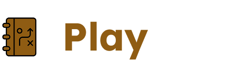

*This project has been created as part of the 42 curriculum by \<melayyad\>, \<mbrouk\>, \<wazadou\>, \<zouazrou\>*

#  PlayBook

[](https://fastapi.tiangolo.com/)
[](https://nextjs.org/)
[](https://react.dev/)
[](https://www.typescriptlang.org/)
[](https://tailwindcss.com/)
[](https://www.postgresql.org/)
[](https://www.docker.com/)
[](https://docs.sqlalchemy.org/)
[](https://caddyserver.com/)

**Find your people. Make the game happen.**

## Table of contents

- [Description](#description)
- [Features](#features)
- [Instructions](#instructions)
- [Resources](#resources)
- [Configuration](#configuration)
- [Development commands](#development-commands)
- [Project structure](#project-structure)

## Description

PlayBook is a sports social network where users can announce a match, find the required number of players, and organize games with teammates in any supported sport. Players can also browse available matches and apply to join one whenever they find a game they would like to play. It also helps users connect with other sports enthusiasts and stay in touch before and after the game.

## Features

- **Player profiles** — Create an account, manage your profile and avatar, select sports and control active sessions.
- **Social feed** — Publish posts, follow players, and browse player activity.
- **Matchmaking** — Announce matches, filter and browse opportunities, and send join requests.
- **Realtime communication** — Chat with live presence, read receipts, notifications, and offline message delivery.
- **Multilingual interface** — Use English, French, or Arabic, including RTL layout support for Arabic.

## Instructions

### Requirements

- [Docker Engine](https://docs.docker.com/engine/install/) or [Docker Desktop](https://www.docker.com/products/docker-desktop/) with [Docker Compose v2](https://docs.docker.com/compose/install/)
- [Make](https://www.gnu.org/software/make/) (recommended; it provides the project commands)
- Local ports `3443` and `8443` available

### Install and run

1. From the repository root, create the environment file:

	```bash
	cp .env.example .env
	```

2. Open `.env` and set the database credentials. Keep `postgres` as the host in `DATABASE_URL`, because it is the Docker Compose service name. For local HTTPS, keep `NEXT_PUBLIC_API_URL=https://localhost:8443` and `CORS_ORIGINS=["https://localhost:3443"]` unless your setup uses different URLs.
3. Build and start the complete application:

	```bash
	make up
	```

	The first build may take a few minutes. The command starts PostgreSQL, the FastAPI backend, the Next.js frontend, and Caddy.
4. Open the application using one of these URLs:

| Service | URL |
| --- | --- |
| Web app | [https://localhost:3443/en](https://localhost:3443/en) |
| API | [https://localhost:8443](https://localhost:8443) |
| OpenAPI docs | [https://localhost:8443/docs](https://localhost:8443/docs) |
| Health check | [https://localhost:8443/health](https://localhost:8443/health) |

The proxy uses local HTTPS certificates. Your browser may require accepting the local certificate the first time you open the application.

5. Stop the services when finished:

	```bash
	make down
	```

Use `make clean` only when you also want to delete the database, uploaded files, and Docker volumes.

## Resources

- [Next.js documentation](https://nextjs.org/docs)
- [next-intl documentation](https://next-intl.dev/docs)
- [FastAPI documentation](https://fastapi.tiangolo.com/)
- [SQLAlchemy documentation](https://docs.sqlalchemy.org/)
- [Docker Compose documentation](https://docs.docker.com/compose/)
- [Python API Development with FastAPI](https://notes.kodekloud.com/docs/Python-API-Development-with-FastAPI )

## Configuration

The root `.env` file is loaded by Docker Compose. Start with [.env.example](.env.example) and change credentials before using the stack beyond local experimentation.

| Variable | Purpose |
| --- | --- |
| `POSTGRES_USER`, `POSTGRES_PASSWORD`, `POSTGRES_DB` | PostgreSQL credentials and database name |
| `DATABASE_URL` | Async SQLAlchemy connection string; use `postgres` as the Compose database host |
| `CORS_ORIGINS` | JSON list of browser origins allowed by the API |
| `SESSION_COOKIE_*` | Session cookie name, lifetime, security, and SameSite behavior |
| `NEXT_PUBLIC_API_URL` | Browser-facing API URL; changing it requires rebuilding the frontend image |

## Development commands

| Command | Description |
| --- | --- |
| `make up` | Build and start all services, then print local URLs |
| `make down` | Stop the services |
| `make restart` | Stop and start the full stack |
| `make status` | Show running containers |
| `make app-logs` | Follow backend and frontend logs |
| `make urls` | Print application URLs |
| `make clean` | Stop services and delete database, upload, and proxy volumes |

For local development without a containerized API, start PostgreSQL with `docker compose up -d postgres`, install backend dependencies with `uv sync`, and run `uv run uvicorn app.main:app --reload` from `back/`. The frontend can be run from `front/playbook-web/` with `yarn install` and `yarn dev`.

## Project structure
```text
.
├── back/                 # FastAPI application and database models
│   └── app/
│       ├── core/         # Settings, security, limits, and error handling
│       ├── models/       # SQLAlchemy application models
│       ├── realtime/     # WebSocket protocol and realtime services
│       ├── routers/      # REST route modules
│       └── schemas/      # Pydantic request and response schemas
├── front/playbook-web/   # Next.js application
├── docs/                 # Architecture notes and diagrams
├── Caddyfile             # Local HTTPS reverse-proxy routes
├── docker-compose.yaml   # PostgreSQL, API, frontend, and Caddy services
└── Makefile              # Common development commands
```
